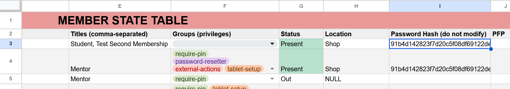

# FAQ

## What's the difference between the global admin PIN and an admin member's PIN?

The global admin PIN is used to access the **app's configuration settings and logs**. It is a universal PIN that allows authorized users to manage the app's settings.

An admin member's PIN, on the other hand, is specific to individual admin members stored in the Google Sheet. **This PIN is used for clocking in and out if the admin does not use RFID.**

## How do I give an individual member the ability to control tablet settings without using the global admin PIN?

<!-- TODO: add link to docs on the groups system -->
[Assign]() them to the `tablet-setup` group.

Delete the member's "Password Hash" from the Members workbook within the Google Sheet. The member will be prompted to set a new PIN the next time they try to clock in/out.

## What timestamp format is used in the Google Sheets?

Timestamps are recorded in the using a millisecond epoch, using the `=EPOCHTODATE` formula function.

### Example

`=EPOCHTODATE(1792943631783, 2)`

| Component | Example       | Description                              |
|-----------|---------------|------------------------------------------|
| Epoch     | 1792943631783 | Milliseconds since UNIX epoch            |
| Time Unit | 2             | Indicated milliseconds. Will always be 2 |

## Can I make force a member to require a PIN, even if they are signing in with RFID?

<!-- TODO: add link to docs on the groups system -->
[Assign]() them to the `require-pin-badge` and `require-pin` group.

## Can a physical keyboard be used with the app?

Yes, a physical keyboard can be used as a faster method to type in member names, if using RFID is not possible.
**You can't use a physical keyboard if an HID scanner is present**

<!-- TODO: add mention of how to change the scanner setting-->
